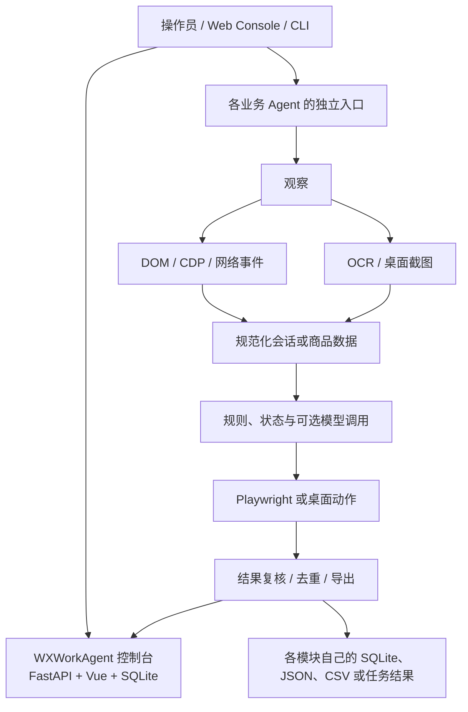

# GUIAgent

GUIAgent 是一组面向具体业务流程的浏览器与桌面自动化 Agent：用 Playwright/CDP 复用已登录的 Chrome，用 DOM 和网络事件读取结构化信息；Windows 桌面流程使用 OCR、窗口操作和键鼠输入；需要自然语言判断或回复时，再接入 Qwen 或外部对话服务。

它是一个多项目工作区，不是一个已统一安装、统一调度的通用 Agent 框架。各子项目有自己的入口、配置、数据和成熟度。本文按当前代码说明已实现能力，并把设计计划与未实现内容单独标出。

## 项目一览

| 模块 | 已有能力 | 当前边界 |
| --- | --- | --- |
| `WXWorkAgent` | 企业微信 PC 客户端 OCR 监听、聊天记录与外部联系人导出、按手机号添加客户、朋友圈任务；FastAPI + Vue 控制台管理线索、会话和归档 | 桌面自动化依赖 Windows、企微客户端和屏幕布局；控制台是目前的平台中枢，但不是所有 Agent 的统一运行时 |
| `DouyinCSAgent` | 通过 CDP 读取当前/可见客服会话，结合网络响应和 DOM 解析消息；Qwen、RevAI 或本地 Carzone 兼容服务生成回复；支持 dry-run、显式发送、去重状态和会话归档 | 主要覆盖当前及可见会话，不等于完整的账号历史同步；发送依赖已登录浏览器和抖音页面结构 |
| `ECAgent` | 淘宝关键词搜索、销量排序、商品候选与详情字段提取、截图及 JSON/CSV 导出；FastAPI/Vue 控制台展示商品和价格趋势 | 淘宝为 MVP；京东、天猫适配不完整，反爬和页面变化仍需人工处理 |
| `APAgent` | Apple SKU 目录/价格采集；通过任务配置填写购物车、配送和支付信息，运行到订单最终审核页 | 结账自动化在 `ready_for_submit` 停止，代码不会点击最终的 Place Order；支付信息必须使用受保护的本地数据 |
| `PRAgent` | Playwright 抓取 Google News；Qwen-VL 选择页面动作；可选 OmniParser 辅助识别；结果增量写入 CSV/JSON | 独立 CLI 原型，不接入统一 Console；页面布局和模型输出需验证 |
| `GEO` | 面向 DeepSeek、豆包、文心、元宝、千问、Kimi 的网页采集；Go 服务提供异步提问/任务查询、AK/SK 签名和管理页面，并处理回答、引用及账号会话状态 | 依赖平台账号、浏览器会话和外部模型/API；站点风控、登录和验证码可能使任务等待人工处理 |
| `agent_platform` | 线索、会话 API 与 SQLite 的共享层脚手架 | 与 WXWorkAgent 后端有重叠，尚未合并成唯一实现 |

详细能力和状态以 [能力总览](docs/GUIAGENT_CAPABILITIES.md)、[统一架构盘点](docs/AGENT_UNIFIED_ARCHITECTURE.md) 和各模块源码为准。总览中的较早状态说明可能落后于近期 GEO 代码。

## 架构



核心工程取舍是先用 DOM/CDP 读取结构化数据；只有需要处理桌面客户端、弹窗或结构化信息不足时才使用 OCR/视觉和键鼠。模型用于指定的回复或导航环节，网页查找、字段校验、状态迁移和敏感操作仍以显式代码为主。

### 主要技术

| 层 | 技术 |
| --- | --- |
| 浏览器自动化 | Python、Playwright、Chrome DevTools Protocol（CDP） |
| Windows 桌面 | OCR 服务、截图、窗口控制、键鼠输入；依赖 Windows 运行环境 |
| 服务端 | FastAPI（多个 Python 子项目）、Go（GEO 问答服务） |
| 前端 | Vue 3、Vite；电商控制台使用 ECharts |
| 状态与导出 | SQLite、JSON/JSONL、CSV；按子项目独立存储 |
| 模型/外部服务 | DashScope Qwen/Qwen-VL、RevAI Carzone 对话接口；GEO 可选平台官方 API 兜底 |

## 关键工作流

### 客服消息到线索

抖音或企微页面读取新消息 → 归一化会话与消息方向 → 用消息键和本地状态避免重复处理 → 调用所选回复提供方 → dry-run 检查或显式发送 → 将消息/线索上报到 WXWorkAgent Console。手机号识别和线索创建不代表企微好友已通过；添加邀请、客户同意等环节仍有平台状态。

企微桌面识别由 OCR 服务提供文字/坐标，脚本在发送或添加客户后检查页面状态。布局、缩放和窗口焦点变化仍可能影响定位，因此 live 操作必须先在正确账号和联系人上 dry-run。

### 商品价格追踪

ECAgent 连接已登录 Chrome CDP → 输入关键词并搜索 → 尝试切换销量排序 → 提取候选商品 → 对有限候选进入详情页补充字段 → 保存截图及 JSON/CSV → 控制台按采集批次展示商品快照和趋势。当前验证重点是淘宝；不能把 JD/Tmall 规划或探针描述成完整生产适配器。

### GEO 多平台问答

批量脚本或业务 API 提交问题 → 创建异步 job → 各站点使用独立网页流程/账号会话 → 采集回答与真实引用 → 写入结果并供轮询或回调读取。Go 服务有 AK/SK HMAC 鉴权、任务状态、站点级结果和管理/监控页面。网页回答与官方 API fallback 会标记来源差异；官方 API 回答不等于网页分享链接。对登录、验证码和账号额度问题，不应把“任务已入队”或“HTTP 202”当成回答成功。

接口格式、状态、签名与错误码见 [GEO API 文档](GEO/server/API.md)。

### Apple 结账安全边界

APAgent 将 SKU、身份资料和订单任务拆开保存，按任务完成商品选择、购物车、配送、账单和支付表单流程。代码在最后审核页面写入 `ready_for_submit` 后结束，并明确不点击下单按钮；这不是无人值守的完整购买系统，也不包含 PCI 合规的支付保险库。

## RevAI 是什么

在本项目中，`RevAI` 指 `https://car.revai.cn` 上的 **Carzone 文本客服回复接口**。`RevaiQaClient` 发送 JSON（`session_id`、`message`、`message_type`，企微还可带 `channel`），可选使用 `REVAI_API_KEY` 作为 Bearer 凭据，并从响应读取 `reply`。它不是本仓库实现的模型，也没有调用语音转写接口；仅凭当前代码无法断言该服务背后的模型、训练数据或服务商实现。

`local_carzone` 是另一条路径：本地兼容 HTTP 服务把消息交给单独的 `car-agent` 纯 LLM baseline，再按兼容格式返回。它与 `car.revai.cn` 远程接口共享客户端协议，但不是同一个部署。Qwen 则通过 DashScope 客户端直接调用。面试时应把这些称为外部模型/服务集成，不要说成项目自行训练或实现了 RevAI 模型。

## Agent 工程知识点

以下知识点整理自项目准备的 Vibe Coding 与 Agent 工程面试题，并结合本仓库举例。它们是工程方法和面试讨论框架，不表示仓库已经全部实现了自动化治理或 CI。

### 需求、上下文与完成标准（Q101–Q108）

- Vibe coding 适合快速试错，但正式交付仍需要规格、代码审查、测试和可追溯结果。使用 Coding Agent 完成开发，与实现一个具备模型循环、工具协议、状态和停止条件的 Agent 系统是两件事。
- 一条可执行任务说明至少有目标、复现输入、期望行为、改动范围、约束和验收命令。根因只是猜测时，先验证，不把猜测写成实现前提。
- 项目规则（如 `AGENTS.md`）写长期有效、能检查的约定；详细背景放在按需文档。给 Agent 提供入口、相关接口和最小复现，避免把整仓库日志都塞进上下文。
- “完成”要对应行为、验证、文档和未解决风险的证据，而不只是 Agent 报告 done。简单文案改动不需要机械增加镜像测试，验证强度应与风险相符。

### 正确性与调试（Q109–Q116）

- 按风险组合单元测试、集成测试、API 契约、端到端场景和不变量检查。测试依据应独立来自需求、已知样例或参考实现，避免实现和测试共同固化同一错误假设。
- 对 UI 自动化，检查不仅是 HTTP 成功：还要核实页面确实打开目标会话、提取到正确方向的新消息、去重状态正确，以及发送/下单状态是否实际到达。
- 依赖 API 以仓库锁定版本和真实运行结果为准；review 关注异常路径、兼容性、硬编码样例、错误吞掉、断言放宽和无关 diff。
- 调试先建立最小复现和候选假设，再一次验证一个假设。连续尝试没有新证据时回到最小复现，不靠重复重试把偶然成功当成修复。
- 检查结果必须对应最终提交；修复后重跑受影响检查。一次旧版本通过、flaky 重试通过或只检查 HTTP 200，都不能证明最终行为正确。

### 长任务与上下文（Q117–Q122）

- 分开看推理耗时、回答篇幅和上下文膨胀，它们是不同问题。长任务交接保留目标、基线提交、已确认事实、失败尝试、检查结果、未完成项和下一步。
- 摘要要指向文件、行号、测试和日志路径；恢复时重新检查 git status、实际源码和最终 diff，不能把旧交接记录当作当前事实。
- 按任务复杂度写 Prompt 和计划：简单、可逆任务直接修改并验证；跨模块改动拆成可验收里程碑。工具调用设置超时、重试上限与停止条件，避免无进展循环。

### 文档与事实来源（Q123–Q128）

- 为不同事实选择权威来源：实际行为看代码和测试，请求字段看 schema，默认配置看配置定义，架构目标看已确认设计，性能数据看真实测量记录。
- 对外接口、配置和启动行为变更，应在同一改动中同步代码、示例、测试和文档。README 中的核心命令应实际运行；链接与 schema 可由 CI 检查，但 CI 不能判断所有业务语义是否正确。
- README 讲定位与上手，架构文档讲模块边界和取舍，ADR 记录决策，任务/交接记录当前进度。过时设计文档要明确标注，而不是伪装成现状。

### 协作、权限与安全（Q129–Q134）

- 大任务按行为里程碑拆分；只有输入输出明确、改动区域独立的工作才适合并行。集成后仍要在最终版本运行检查。
- 对 Agent 提供最小必要工具权限。网页、issue、日志和代码注释属于不可信数据，不能自行覆盖任务要求或提升执行权限；敏感写操作应有明确触发条件和结果复核。
- 密钥用环境变量或密钥管理服务；提交和日志都不要包含真实 token、短信验证码、完整手机号、会话 cookie 或生产数据库。用无效占位符的示例配置。
- 新增依赖前先检查现有依赖能否满足需求；如果改锁文件，要说明版本变化并按目标环境验证。

### 评估、模型选择与相关概念（Q135–Q140）

- 评估 Coding Agent 是否提效，应记录可验收任务完成率、总耗时、审查/返工成本、回归缺陷和模型/工具费用；没有基线与样本，不编造“提效百分比”。模型按任务难度、延迟、成本、工具能力和验证成本选择。
- 项目规则描述仓库约定；Skill 封装一类工作流程；MCP 是外部工具/上下文连接协议；工具调用是模型请求某项已提供能力的交互方式。接入 MCP 不会自动保证数据可信、权限正确或调用成功。本仓库没有通用 MCP runtime。
- 研究/算法任务需要独立参考值、shape/数值范围、精度、随机性、数据切分和指标检查。本项目不是模型训练代码；同样的独立 oracle 思路可用于页面解析、消息去重和价格换算。
- RAG 版本混用是面试题中的验证场景，不是本仓库功能。正确思路是让版本过滤贯穿检索、重排、缓存和引用；用 R1/R2 对照、无匹配版本、默认版本和跨版本缓存测试证明边界，不能只靠生成 Prompt 提醒模型。
- 讲项目时区分“已实现、试验性、计划中”和“面试时提出的方法”。只描述自己确实完成并能展示代码/测试证据的贡献，不把题目里的教学示例说成项目经历。

## 上手与运行

根目录没有统一的 `requirements.txt`、一键安装器或全局任务队列；按要看的模块分别安装依赖。常见前提是 Python 3.11、Node.js（控制台前端）和已登录的 Chrome CDP。企微桌面脚本要求 Windows；GEO Go 服务还需要 Go 工具链和单独的服务配置。

### 淘宝采集 MVP

```powershell
cd ECAgent
py -3.11 -m pip install -r requirements.txt
copy config.example.yaml config.yaml
py -3.11 eca_taobao.py --keyword "冈本 003" --max-candidates 12 --detail-limit 5
```

运行前需启动已登录 Chrome 并暴露 CDP（默认 `http://127.0.0.1:9222`）。配置和浏览器登录态不要提交。

### Google News 抓取

```powershell
cd PRAgent
py -3.11 -m pip install -r requirements.txt
$env:DASHSCOPE_API_KEY = "<your-key>"
py -3.11 main.py --keyword "XREAL" --pages 30 --output xreal_news.csv
```

可选 OmniParser 服务通过 `config.yaml` 启用；未配置时走 DOM 摘要路径。

### WXWork Console

```powershell
cd WXWorkAgent
py -3.11 -m pip install -r requirements.txt
py -3.11 -m uvicorn web.backend.main:app --host 127.0.0.1 --port 8000
```

前端在 `WXWorkAgent/web/frontend`，运行 `npm ci`、`npm run dev`。后端 README 还说明 OCR 服务和导出数据的本地目录。

### GEO

六平台批量网页采集入口为 `GEO/batch_scrape_cn.py`；Go 服务配置样例、签名、接口和任务状态见 [GEO/server/API.md](GEO/server/API.md) 与 [GEO/server/OPERATIONS.md](GEO/server/OPERATIONS.md)。运行需要相应平台登录会话或外部 API 凭据；短信登录手机号按需通过 `CN_AI_PHONE` 或 `GEO_YUANBAO_PHONE` 在本地环境配置，验证码不进入源码或提交记录。不应在未配置账号和本地数据目录时直接启动生产模式。

抖音回复、Apple 结账、企微桌面和 ECAgent 控制台均有不同配置/登录前置条件，详见模块文档。并非每个子项目都包含完整的可公开配置样例。

## 当前限制

- 共享的 `webagent/` 核心包并不存在；`UI-TARS-desktop/` 是占位。浏览器连接、状态与运行入口仍有重复。
- WXWorkAgent Console 是事实上的线索/会话中枢；ECAgent 和 APAgent 有独立控制台，PRAgent 是 CLI，GEO 是单独服务。不要将它们描述成同一个统一调度平台。
- 网页自动化依赖第三方 UI 和账号状态。DOM 变化、弹窗、验证码、限流和登录过期都可能中断任务；项目不会自动破解验证码。
- OCR 坐标受 Windows 缩放、屏幕布局和窗口焦点影响。关键写操作要先 dry-run 或用测试账号验证。
- 外部模型和 RevAI 的可用性、价格及回答质量不由仓库控制；除代码已有状态外，不提供统一准确率或延迟基准。

## 面试展示方式

可以用“问题—链路—边界—证据”介绍：这是一个围绕真实业务网页和 Windows 客户端的工作流自动化项目；展示一条具体闭环（例如新消息识别、去重、模型回复、发送前检查、归档）；说明用了哪些结构化读取和 UI 兜底；最后诚实说明哪些模块仍独立、哪些依赖登录态、以及怎样验证安全停止。根据自己实际完成的工作调整第一人称表述。

不要声称本项目训练了 LLM、实现了通用 RAG、集成了 MCP、全量覆盖抖音历史会话或自动下完 Apple 订单；代码与文档目前不支持这些说法。没有实测数据时，也不要给准确率、成功率或提效数字。

## 文档索引

- [能力总览](docs/GUIAGENT_CAPABILITIES.md)
- [统一架构盘点](docs/AGENT_UNIFIED_ARCHITECTURE.md)
- [WebAgent Core 设计（规划文档）](docs/WEBAGENT_CORE_ARCHITECTURE.md)
- [抖音/企微私域需求与实现边界](docs/DOUYIN_WXWORK_PRIVATE_DOMAIN_PRD.md)
- [ECAgent 淘宝入口](ECAgent/README.md)
- [WXWork Console 启动](WXWorkAgent/web/README.md)
- [PRAgent 入口](PRAgent/README.md)
- [GEO API](GEO/server/API.md)
- [APAgent 架构说明](docs/APAGENT_PRODUCTION_ARCHITECTURE.md)

最后核对：2026-10-31。
